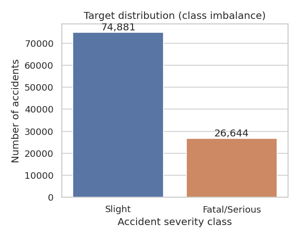
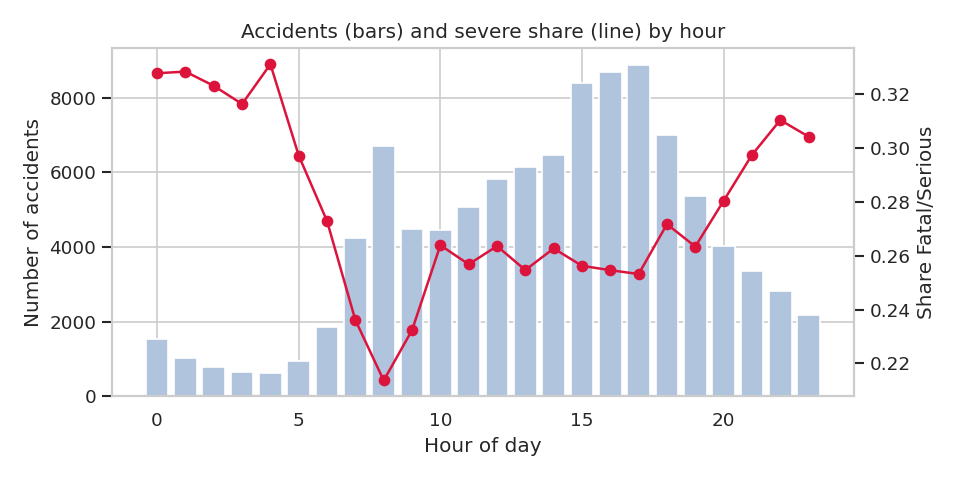
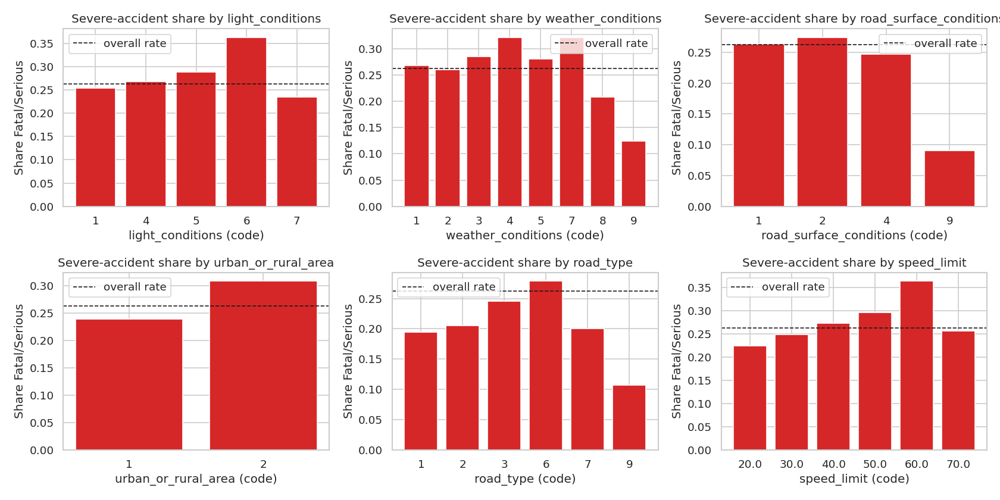
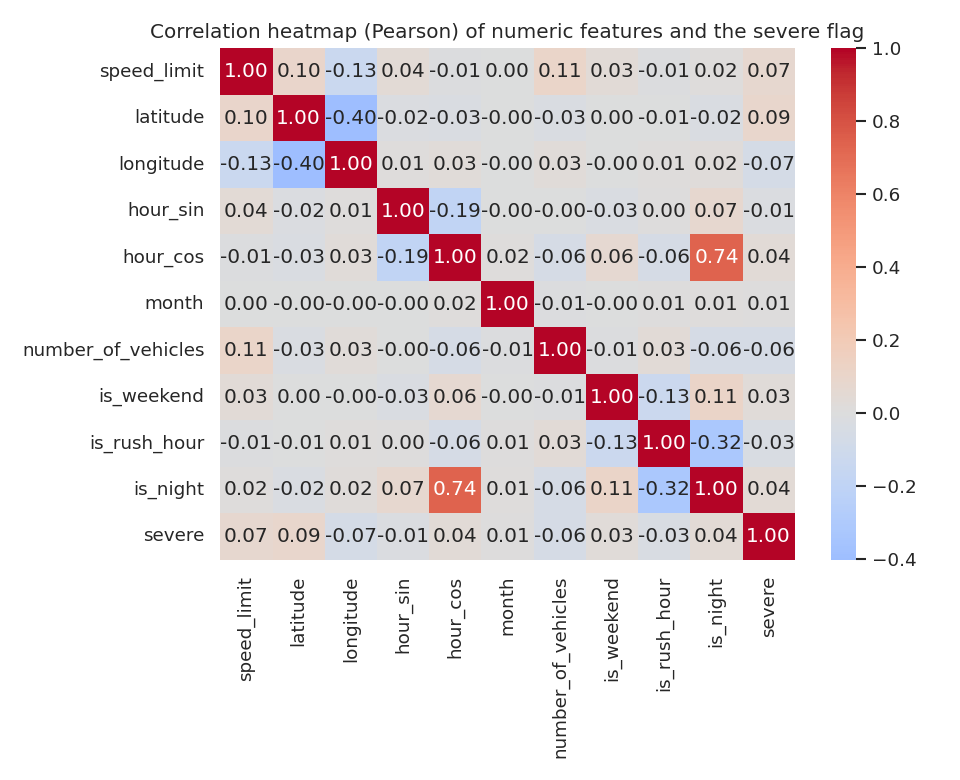
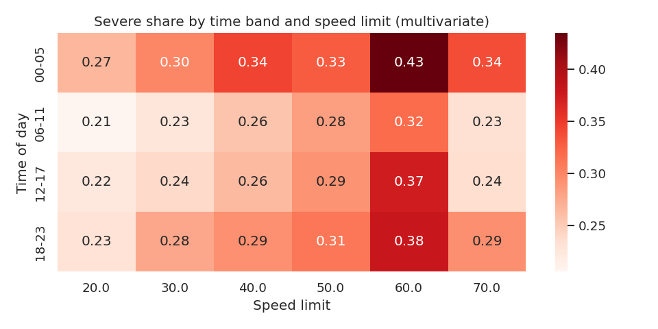
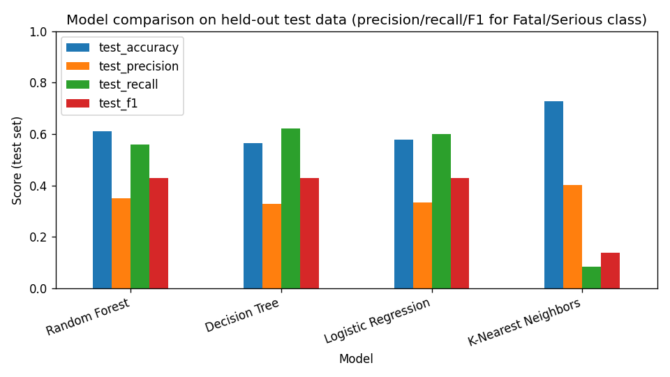
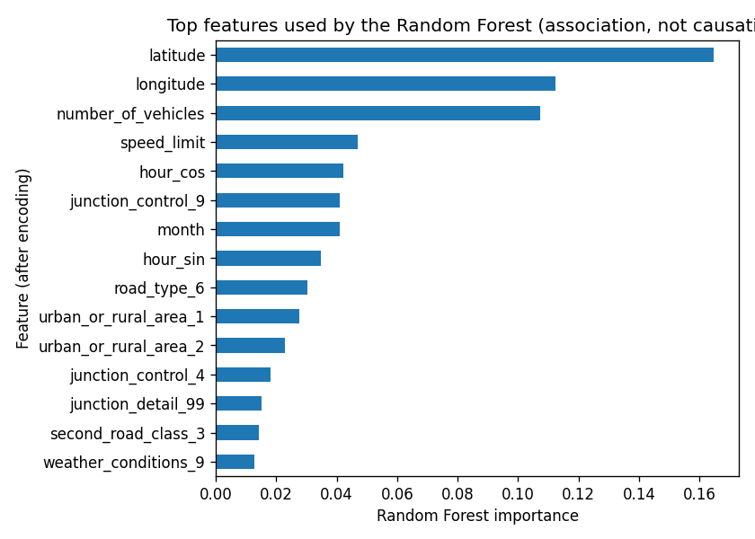

# AI-Based Road Safety Monitoring and Accident Risk Analysis System

**Student:** Junaid Naeem  
**Roll number:** SU92-BCSFM-F26-041  
**University:** Superior University

## 1. Problem and objectives
This educational project analyses real road-accident records and real road/motorcycle images in one workflow: (A) accident analytics and severity prediction, (B) classical computer-vision analysis of images. The two components share the road-safety objective but use **separate datasets**: no image is linked to any accident record, and no claim of such a link is made.

## 2. Data
Dataset names, links and licences are listed in `LICENSE_AND_DATA_SOURCES.md`.
- Raw accident file: **101,525 rows x 44 columns**. After cleaning: **101,525 rows x 51 columns**.
- Target `severe` (fatal or serious = 1): {'0': 74881, '1': 26644} (26.2% severe).

## 3. Data cleaning decisions
| Problem found | Method applied | Why |
|---|---|---|
| Whitespace and text tokens such as 'Data missing or out of range' hide real missing values | Stripped text and replaced tokens with NaN | Missing values must be recognised before they can be analysed |
| Coded columns use -1 for 'data missing or out of range' | Replaced -1 with NaN in coded columns | -1 is not a real category; treating it as a number would distort statistics |
| Duplicate records inflate counts and can leak between train/test sets | Dropped exact duplicate rows, then repeated accident_index values (keep first) | accident_index uniquely identifies an accident record |
| Dates, times and counts are stored as text | Parsed dates (day-first) and HH:MM times, coerced numbers | Needed for time features; unparseable values become NaN instead of crashing |
| Coordinates outside the valid range | Set to NaN | Impossible values are errors, not outliers |
| Extreme counts (many vehicles/casualties) found with the 1.5xIQR rule | Kept the rows; reduced skew with a log1p transform inside the modelling pipeline | Large multi-vehicle crashes are real events, and they are the rare serious ones we care about |
| Raw date/time cannot be used directly by models | Created hour, month, weekday, weekend/rush-hour/night flags and cyclic hour_sin/hour_cos | Hour 23 and hour 0 are neighbours; the cyclic encoding preserves that |
| Severity has three levels (1 fatal, 2 serious, 3 slight) and fatal is very rare | Binary target severe = fatal or serious | Keeps enough positive cases to learn from; rows without severity are unusable for supervised learning |
| Columns with more than 50% missing values carry too little information | Dropped them (rows kept) | Rows with some missing fields are retained; remaining gaps are imputed later inside the pipeline |

## 4. Exploratory data analysis
1. The cleaned dataset has 101,525 accidents; 26.2% are Fatal/Serious and 73.8% Slight, so the classes are imbalanced and accuracy alone would be misleading.
2. Number of vehicles is right-skewed: median 2, 95th percentile 3, maximum 17. These large crashes are real events, so they were kept and a log transform is used for modelling.
3. The share of Fatal/Serious accidents is highest at hour 4 (33.1%, n=634) and lowest at hour 8 (21.4%); the busiest hour for accidents is 17:00.
4. By speed limit, the severe share ranges from 22.4% (value 20.0) to 36.4% (value 60.0) among groups with at least 203 accidents.
5. By light-condition code, the severe share ranges from 23.4% (value 7) to 36.3% (value 6) among groups with at least 203 accidents.
6. By urban/rural code, the severe share ranges from 23.9% (value 1) to 30.9% (value 2) among groups with at least 203 accidents.
7. Weekend accidents are 28.5% severe versus 25.5% on weekdays.
8. The strongest linear correlation with the severe flag is latitude (r=+0.09); all correlations are weak-to-moderate and, being observational, do not show causation.
9. After cleaning, 'junction_control' has the most remaining missing values (43.8%); these are imputed inside the modelling pipeline (training data only).

Associations are observational and do not prove causation.



*Target distribution*



*Accidents and severe share by hour*



*Severe share by feature*



*Correlation heatmap*



*Time band x speed limit*


## 5. Image processing
_Not available: this stage has not been run (or was skipped). Run `python main.py all` after adding the data._

## 6. Feature detection and matching
_Not available: this stage has not been run (or was skipped). Run `python main.py all` after adding the data._

## 7. Image classification (ORB Bag of Visual Words + SVM/k-NN)
_Not available: this stage has not been run (or was skipped). Run `python main.py all` after adding the data._

## 8. Accident machine learning
Prediction problem: severe (1 = fatal or serious, 0 = slight) using only information available at the time of the accident report (no casualty counts, no police-attendance flag). 48,000 training / 12,000 test rows (stratified, random_state=42). Majority-class baseline accuracy: 0.738.

| model | test_accuracy | test_precision | test_recall | test_f1 | test_roc_auc | train_f1 | fit_diagnosis |
|---|---|---|---|---|---|---|---|
| Random Forest | 0.611 | 0.349 | 0.559 | 0.430 | 0.635 | 0.491 | no strong sign of over/underfitting |
| Decision Tree | 0.566 | 0.328 | 0.622 | 0.429 | 0.613 | 0.453 | no strong sign of over/underfitting |
| Logistic Regression | 0.580 | 0.333 | 0.600 | 0.428 | 0.616 | 0.435 | no strong sign of over/underfitting |
| K-Nearest Neighbors | 0.727 | 0.402 | 0.084 | 0.140 | 0.584 | 0.230 | possible underfitting |

**Best model:** Random Forest. 'Random Forest' was selected because it has the highest F1-score for the Fatal/Serious class on held-out data. Severe accidents are the minority class, so accuracy is misleading (always predicting 'Slight' would already score 0.738). F1 balances precision (avoiding false alarms) and recall (not missing severe cases). If missing a severe case were considered worse than a false alarm, recall should be prioritised instead.



*Model comparison*



*Random Forest feature importance*


## 9. Limitations
- Accident records are observational: associations (and model feature importances) are **not** causal.
- Predictions are educational and do not guarantee, measure or improve actual road safety.
- Under-reporting of slight accidents, coded categories and one national/regional source limit generalisation.
- Image results depend on the chosen image dataset; classical ORB features are weaker than modern deep learning.
- The system does **not** detect helmet violations or analyse live video; no object-detection model was trained.

## 10. Run status
```
{'check': 'ok', 'clean': 'ok', 'eda': 'ok', 'model': 'ok'}
```

## 11. Conclusion
The project provides a reproducible pipeline combining cleaning, EDA, classical image analysis and tabular machine learning under one road-safety theme. Conclusions are limited to the numbers shown above.